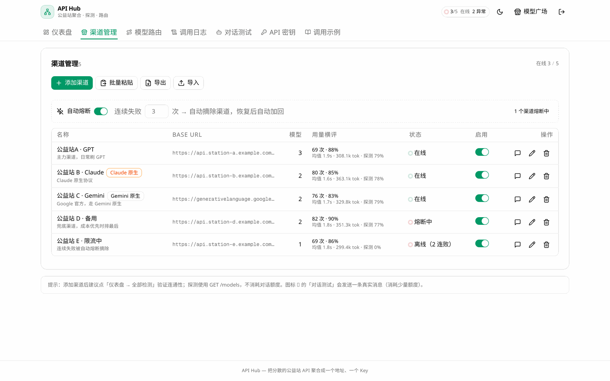
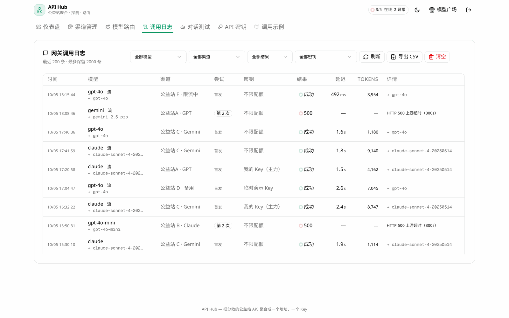

# 安装部署指南

三套装法覆盖98% 场景，按你的环境挑一种即可。装完都是**常驻服务 + 开机自启**。

| 你的情况 | 用哪种 | 章节 |
|---------|--------|------|
| Linux 服务器（有 systemd） | 脚本安装 | [方式一](#方式一linux-脚本安装) |
| Windows 10/11 | PowerShell 脚本 | [方式二](#方式二windows-脚本安装) |
| 不想装 Node / 无root / 容器环境 | Docker | [方式三](#方式三docker-部署) |
| 想手动接管进程 | 手动部署 | [方式四](#方式四手动部署systemd--nssm) |
| 只想要二进制产物，不想装依赖 | Release tarball | [方式五](#方式五release-tarball-免依赖部署) |

> **需要 GitHub PAT**：仓库为私有，拉源码需令牌（勾选 `repo` 即可）。
> 令牌只用于下载源码，脚本不会上传任何数据。别把它写进脚本或提交进仓库。

### 仓库自带的部署物料

| 文件 | 用途 |
|------|------|
| `deploy/systemd/api-hub.service` | systemd 单元（含安全加固、优雅停机、重启节流） |
| `deploy/nginx/api-hub.conf` | nginx 反代样例（SSE 关缓冲、登录限流、健康检查内网限制） |
| `deploy/nginx/api-hub-http2.conf` | HTTP/2 片段（按 nginx 版本二选一，见文件内说明） |
| `deploy/env/api-hub.env.example` | 集中管理端口/时区/日志级别的环境变量样例 |
| `deploy/logrotate/api-hub` | 日志文件轮转（不走 journald 时才需要） |
| `deploy/windows/register-service.ps1` | 手动把已装好的目录注册为 Windows 服务 |
| `deploy/windows/unregister-service.ps1` | 卸载 Windows 服务（默认保留数据） |

---

## 方式一：Linux 脚本安装

覆盖 Ubuntu / Debian、RHEL / CentOS / Fedora、Alpine、Arch、openSUSE（自动探测包管理器）。

```bash
T=ghp_你的GitHub令牌
curl -fsSL -H "Authorization: Bearer $T" -H "Accept: application/vnd.github.raw" \
  https://api.github.com/repos/plxlaaa/api-hub/contents/install-api-hub.sh \
  -o install-api-hub.sh
bash install-api-hub.sh --token "$T" --domain hub.example.com
```

脚本会依次完成：装 Node 20+ / bun → 拉源码 → 装依赖 → 生成 Prisma Client → 建库 →
构建 → 注册 systemd 服务 `api-hub` → 健康检查 → 打印首次设置令牌。

### 常用参数

| 参数 | 说明 | 默认 |
|------|------|------|
| `-d, --dir` | 安装目录 | `/opt/api-hub` |
| `-p, --port` | 监听端口 | `3000` |
| `-b, --branch` | 安装分支 | `main` |
| `--domain` | 绑定域名，自动装 Caddy 并签 HTTPS | 无 |
| `--cn` | 走 npmmirror 国内镜像 | 关闭 |
| `--firewall` | 自动放行防火墙端口 | 关闭 |
| `--precheck` | 只做环境自检，不安装 | — |

### 运维动作

| 动作 | 命令 |
|------|------|
| 更新代码（自动备份 db） | `bash install-api-hub.sh --update --token "$T"` |
| 查看运行状态 | `bash install-api-hub.sh --status` |
| 重新打印设置令牌 | `bash install-api-hub.sh --status` |
| 只做环境自检 | `bash install-api-hub.sh --precheck` |
| 卸载（保留数据库） | `bash install-api-hub.sh --uninstall` |
| 卸载并删除数据库 | `bash install-api-hub.sh --uninstall --purge` |

### 没有 systemd 的环境

容器、精简镜像、WSL 里没有 systemd，脚本会自动**降级为前台进程 + nohup 守护**，
并提示自启方式（rc.local / crontab@reboot）。功能不受影响，只是没有
`systemctl` 那些便捷命令。

### systemd 手工配置（想自己接管时）

`deploy/systemd/api-hub.service` 是可直接使用的单元文件：

```bash
sudo cp deploy/systemd/api-hub.service /etc/systemd/system/
sudo systemctl daemon-reload
sudo systemctl enable --now api-hub
sudo systemctl status api-hub
journalctl -u api-hub -f          # 跟踪日志
```

### 集中管理配置项（改端口不用改 unit）

把易变项挪到 env 文件，之后改端口/时区/日志级别只需编辑该文件并重启：

```bash
sudo cp deploy/env/api-hub.env.example /etc/api-hub/api-hub.env
sudo chown api-hub:api-hub /etc/api-hub/api-hub.env
sudo chmod 600 /etc/api-hub/api-hub.env
# 编辑内容后，编辑 systemd 单元取消注释这一行：
#   EnvironmentFile=/etc/api-hub/api-hub.env
sudo systemctl daemon-reload && sudo systemctl restart api-hub
```

> env 文件会被 systemd 明文读取，**不要往里写任何密钥**。上游 Key 存在 SQLite，
> 网关统一 Key 在管理台创建，都不需要写进环境变量。

### 日志轮转

用 systemd 时日志进 journald，**轮转由 journald 自带能力负责**（`/etc/systemd/journald.conf`），
无需额外配置。只有在下面这些情况下才需要 `deploy/logrotate/api-hub`：

- 用 nohup 降级模式且把日志重定向到 `/var/log/api-hub/*.log`
- 容器部署时把日志目录 bind mount 到宿主机

```bash
sudo cp deploy/logrotate/api-hub /etc/logrotate.d/api-hub
sudo logrotate -d /etc/logrotate.d/api-hub   # 先干跑校验，不实际执行
```

---

## 方式二：Windows 脚本安装

要求 Windows 10 / 11 + PowerShell 5.1+（Win10 自带）。**需要管理员权限**，
脚本会自动请求提权（UAC 弹窗）。

```powershell
# 在 PowerShell 中执行（推荐：会自动申请管理员权限）
irm https://raw.githubusercontent.com/plxlaaa/api-hub/main/install-api-hub.ps1 -outfile install-api-hub.ps1
.\install-api-hub.ps1 -Token ghp_你的令牌 -Port 3000
```

若脚本未能自动提权，手动以管理员身份运行：

```powershell
Start-Process powershell -Verb RunAs -ArgumentList "-NoProfile -ExecutionPolicy Bypass -File `"$PWD\install-api-hub.ps1`" -Token ghp_你的令牌"
```

### 常用参数

| 参数 | 说明 | 默认 |
|------|------|------|
| `-Port` | 监听端口 | `3000` |
| `-Dir` | 安装目录 | `C:\api-hub` |
| `-Branch` | 安装分支 | `main` |
| `-Domain` | 绑定域名（自动装 Caddy 并签 HTTPS） | 无 |
| `-Cn` | 走国内镜像 | 关闭 |
| `-ServiceUser` | 服务运行账户（默认 `LocalSystem`） | `LocalSystem` |

### 注册为 Windows 服务

脚本默认用 **NSSM** 把网关注册为 Windows 服务：

| 动作 | 命令（管理员 PowerShell） |
|------|------|
| 查看服务状态 | `Get-Service api-hub` |
| 启动 / 停止 | `Start-Service api-hub` / `Stop-Service api-hub` |
| 重启 | `Restart-Service api-hub` |
| 卸载服务 | `nssm stop api-hub; nssm remove api-hub confirm` |
| 实时日志 | 日志文件见下|

日志路径：`%ProgramData%\api-hub\logs\api-hub.err.log`（NSSM 捕获 stdout/stderr，
已配置 10MB 自动轮转）。

> **服务注意事项**
> - 服务以 `LocalSystem` 运行时，**无盘符映射**（如 `Z:\`）不可用，路径一律写绝对路径。
> - 若要用网络路径上的数据目录，请改用 `-ServiceUser域\账号` 并授予该账号权限。
> - 卸载脚本请走 `nssm remove`，直接删文件夹会留下服务注册项。

### 手动注册服务（换机器 / 重装系统后）

已装好但服务丢了（比如重装系统、重置服务注册表），不必重跑安装脚本：

```powershell
# 需已安装 NSSM：winget install nssm.nssm
.\deploy\windows\register-service.ps1 -Dir 'C:\api-hub' -Port 3000
```

脚本会自动探测 `node.exe` 路径、写入开机自启、配置崩溃重启与日志轮转，
然后轮询 `/api/health` 确认真的起来了（最多等 30 秒）。

> ⚠️ `node.exe` 必须用**绝对路径**：服务环境不继承你的用户 PATH，
> 用相对路径或 PATH 里的名字会启动失败。

卸载服务（默认会先把 `db/` 打包备份到桌面）：

```powershell
.\deploy\windows\unregister-service.ps1              # 保留数据目录
.\deploy\windows\unregister-service.ps1 -Purge       # 连目录一起删（不可恢复）
```

### 包管理器分发

NSSM 与 Node.js 都可以走包管理器，省去手动下载：

```powershell
winget install OpenJS.NodeJS.LTS      # 或 winget install Oven-sh.Bun
winget install nssm.nssm

# 其他可选
choco install nodejs nssm
scoop install nodejs nssm
```

> API Hub 本身是私有仓库，**没有 winget/choco/scoop 的官方包**。
> 这些工具只用来装依赖（Node / bun / NSSM），安装仍走上面的脚本或手动步骤。

### WSL2 部署

不想在 Windows 上装 Node、或要跑 Linux 完整环境时：

```powershell
wsl --install -d Ubuntu        # 首次需管理员 + 重启
wsl                            # 进入 Linux
```

进入 WSL 后**直接用方式一**（等同一台 Linux 机器）：

```bash
curl -fsSL -H "Authorization: Bearer $T" -H "Accept: application/vnd.github.raw" \
  https://api.github.com/repos/plxlaaa/api-hub/contents/install-api-hub.sh -o install-api-hub.sh
bash install-api-hub.sh --token "$T"
```

WSL2 访问 Windows 侧浏览器：浏览器打开 `http://localhost:3000`（WSL2 有端口转发）。
注意 WSL2 的 systemd 默认不启用，脚本会自动降级为 nohup 守护。

---

## 方式三：Docker 部署

### docker compose（推荐）

```bash
git clone https://github.com/plxlaaa/api-hub.git && cd api-hub
cp .env.example .env          # 可选：改端口 / 时区 / 国内镜像
docker compose up -d --build
docker compose logs -f
```

国内机器建议在 `.env` 里设`CN_MIRROR=1` 走 npmmirror 加速。

### 纯 docker run

```bash
docker build -t api-hub:latest .

docker run -d \
  --name api-hub \
  --restart unless-stopped \
  -p 3000:3000 \
  -v api-hub-data:/app/db \
  -e TZ=Asia/Shanghai \
  api-hub:latest
```

> ⚠️ **务必挂载 `/app/db`**：该目录存 SQLite 库与凭据文件，不挂载则容器一删数据就没了。

### 常用运维命令

| 动作 | 命令 |
|------|------|
| 查看状态 / 健康 | `docker compose ps` |
| 跟踪日志 | `docker compose logs -f` |
| 停止（保留数据） | `docker compose down` |
| 停止并删卷（**会丢数据**） | `docker compose down -v` |
| 备份数据库 | `docker run --rm -v api-hub-data:/data -v "$PWD":/backup alpine tar czf /backup/api-hub-$(date +%F).tgz -C /data .` |

### 反向代理

仓库自带 `Caddyfile`（自动 HTTPS）。用 nginx 参考 `deploy/nginx/api-hub.conf`：

```bash
sudo mkdir -p /etc/nginx/snippets
sudo cp deploy/nginx/api-hub.conf /etc/nginx/conf.d/api-hub.conf

# HTTP/2 片段必须按 nginx 版本二选一，否则 nginx -t 会失败：
#   nginx >= 1.25 → 用 `http2 on;`
#   nginx <  1.25 → 片段留空，并把 conf 里 443 那行改成 listen 443 ssl http2;
nginx -v        # 先确认版本
sudo cp deploy/nginx/api-hub-http2.conf /etc/nginx/snippets/

# 证书路径换成你自己的（仓库默认 hub.example.com）
sudo sed -i 's/hub.example.com/hub.你的域名.com/g' /etc/nginx/conf.d/api-hub.conf

sudo nginx -t && sudo systemctl reload nginx
```

> HTTP/2 的写法在 nginx 1.25 发生过不兼容变更，两种写法互斥。
> 详细说明与切换方法见 `deploy/nginx/api-hub-http2.conf` 文件内注释。

---

## 方式四：手动部署（systemd / NSSM）

适合要把网关纳入自有运维体系（Ansible、salt、CI/CD）的场景。

### 通用前置

```bash
# Node 20+ 与 bun
curl -fsSL https://bun.sh/install | bash

git clone https://github.com/plxlaaa/api-hub.git /opt/api-hub
cd /opt/api-hub
bun install
npx prisma generate
npx next build
```

`db/` 目录**不需要**手动创建——服务首次启动会自动建目录、建表（幂等）。

### systemd

```bash
sudo cp deploy/systemd/api-hub.service /etc/systemd/system/
sudo systemctl daemon-reload && sudo systemctl enable --now api-hub
```

### Windows（NSSM）

```powershell
nssm install api-hub "C:\Program Files\nodejs\node.exe" `
  ".next\standalone\server.js"
nssm set api-hub AppDirectory "C:\api-hub"
nssm set api-hub AppEnvironmentExtra "PORT=3000" "HOSTNAME=127.0.0.1" "NODE_ENV=production"
nssm set api-hub Start SERVICE_AUTO_START
nssm start api-hub
```

> 更省事：直接用 `deploy\windows\register-service.ps1`，它会自动补齐崩溃重启、
> 日志轮转、健康检查验证。参数见脚本内`-? ` 或文件头注释。

---

## 方式五：Release tarball（免依赖部署）

不想在生产机上装 Node / bun，也不想用 Docker 时：把构建产物直接打包带走。
`.next/standalone` 已经是自包含产物（依赖已打进 `_next`），只需额外带上静态资源。

### 打包（在有开发环境的机器上执行）

```bash
# 1. 正常构建
bun install && npx prisma generate && npm run build

# 2. 一键打包（推荐）
bash scripts/pack-standalone.sh
# 产物：./api-hub-standalone.tar.gz
```

脚本做了三件手工容易出错的事：

- **规避 `tar -C` 陷阱**：`tar` 的多个 `-C` 是**相对上一个 `-C` 之后的目录**解析的，
  所以 `-C .next/standalone . -C .next/static .next/static` 会去找
  `.next/standalone/.next/static` 并报 `Cannot stat`。脚本改用暂存目录逐项拷贝。
- **剔除凭据与数据库**：`.next/standalone/db/` 里含 `credentials.env`、`custom.db`、
  `custom.db-wal`——这些是开发机的管理员凭据和上游 API Key，直接打包等于公开发布。
  脚本在打包前 `rm -rf db` 并做二次校验，命中即中止。
- **补齐部署物料**：带上 `prisma/`、`deploy/`（systemd、nginx、Windows 脚本）、
  `.env.example`、`INSTALL.md`，解压即可直接注册服务。

> `package.json` 的 `build` 脚本已把 `static` 与 `public` 复制进 `standalone/`，
> 脚本仍会显式补一遍，防止脚本变更导致漏文件。
>
> 想手动打包时，**务必用绝对路径**并排除 `db`：
> ```bash> STAGE=$(mktemp -d)
> cp -a .next/standalone/. "$STAGE/" && rm -rf "$STAGE/db"
> mkdir -p "$STAGE/.next"
> cp -a .next/static "$STAGE/.next/static"
> cp -a public prisma deploy "$STAGE/"
> tar czf api-hub-standalone.tar.gz -C "$STAGE" .
> rm -rf "$STAGE"
> ```

### 部署（目标机器只需 Node 20+）

```bash
T=ghp_你的GitHub令牌
curl -fsSL -H "Authorization: Bearer $T" \
  -o api-hub-standalone.tar.gz \
  https://github.com/plxlaaa/api-hub/releases/latest/download/api-hub-standalone.tar.gz

sudo mkdir -p /opt/api-hub && sudo tar xzf api-hub-standalone.tar.gz -C /opt/api-hub
sudo chown -R api-hub:api-hub /opt/api-hub

# 注册为 systemd 服务
sudo cp /opt/api-hub/deploy/systemd/api-hub.service /etc/systemd/system/
sudo systemctl daemon-reload && sudo systemctl enable --now api-hub
```

### 与源码部署的差异

| 项目 | 源码部署 | tarball 部署 |
|------|---------|-------------|
| 机器依赖 | Node + bun + Prisma CLI | **仅 Node** |
| 升级方式 | `git pull` + 重新构建 | 重新下载 tarball 覆盖 |
| 回滚 | `git checkout` 切标签 | 备份旧目录后重新解压 |
| `npx prisma db push` | 可用 | 不可用（无 CLI），依赖启动时自动建表 |

> ⚠️ tarball 部署**不能执行 schema 迁移**。本项目启动时会自动建表（幂等），
> 新增字段时若涉及迁移，请改用源码部署或在旧机器上迁移后再把 `db/` 一起带走。

---

## 配置项

所有配置通过**环境变量**传入，无需改动代码。

| 变量 | 默认 | 说明 |
|------|------|------|
| `PORT` | `3000` | 监听端口 |
| `HOSTNAME` | `0.0.0.0` | 监听地址。**只用本机反代时设 `127.0.0.1`** |
| `NODE_ENV` | `production` | 运行模式 |
| `TZ` | 系统时区 | 时区，影响日志与统计口径 |
| `DATABASE_URL` | `file:./db/custom.db` | 仅容器内有效；宿主/standalone 部署会忽略 |
| `LOG_LEVEL` | `info` | `debug` / `info` / `warn` / `error` / `silent` |
| `LOG_FORMAT` | `json` | `json`（采集用）/ `text`（人读） |
| `PRISMA_LOG` | — |设为 `query` 打印 SQL，排查慢查询用 |
| `LOG_SILENT` | — | 设为 `1` 静默日志（测试用） |

示例见 `.env.example`。

---

## 数据与备份

| 路径 | 内容 |
|------|------|
| `db/custom.db` | SQLite 主库（渠道、路由、密钥、日志） |
| `db/custom.db-wal` / `-shm` | WAL 附属文件（**不可单独拷贝**，会导致快照不一致） |
| `db/credentials.env` | 管理员凭据哈希（scrypt 加盐） |
| `db/setup-token.txt` | 首次设置令牌 |

**正确备份方式**（服务运行中也安全，SQLite 快照一致）：

```bash
sqlite3 db/custom.db ".backup '/backup/custom-$(date +%F).db'"
# 或用脚本：bash install-api-hub.sh --update（更新前自动备份）
```

> ⚠️ 直接 `cp db/custom.db` 在服务运行中可能拿到不完整快照。停服后拷贝，或用上面的 `.backup`。
> ⚠️ `db/` 含明文 API Key 与凭据，**勿提交进仓库、勿外传**（`.gitignore` 已默认排除）。

---

## 开机自启

| 安装方式 | 自启机制 | 验证命令 |
|---------|---------|---------|
| Linux 脚本（有 systemd） | `systemctl enable api-hub` | `systemctl is-enabled api-hub` |
| Linux 脚本（无 systemd） | nohup + rc.local / crontab | `crontab -l` |
| Windows 脚本 | NSSM 服务 `StartType=Automatic` | `Get-Service api-hub` |
| Docker | `--restart unless-stopped` | `docker inspect -f '{{.HostConfig.RestartPolicy.Name}}' api-hub` |

---

## 健康检查与排错

### 健康检查

推荐用 `/api/health`（无需鉴权，可安全暴露）：

```bash
curl -fsS http://127.0.0.1:3000/api/health
# 正常：{"status":"ok","uptimeSec":123,"db":{"ok":true},"checksMs":1,...}   HTTP 200
#异常：{"status":"degraded",...,"db":{"ok":false,"error":"..."}}          HTTP 503
```

`503` 表示数据库不可用——服务进程还活着，但**不该再往里导流量**。
容器 healthcheck 与 systemd 均可直接依赖此端点。

> 早期版本曾用 `/api/auth/status` 当探针，但它只反映「是否已初始化」，
> **数据库挂了它照样返回 200**。请统一改用 `/api/health`。

### 排错时对照界面

装完之后，下面这几张界面截图能帮你快速确认「服务到底起来没有」——
**页面打得开 = 进程和数据库都正常**，页面打得开但数据全是空或报错，才需要按下面的 FAQ 逐项排查。

**① 仪表盘**：「渠道健康」卡片是最快的自检点——**在线数应等于已启用且未熔断的渠道数**。
若显示 `在线 0 / 异常 N`，去渠道管理页看「状态」列与自动熔断提示，错误原因就写在那一行里。


**② 渠道管理**：每行的「状态」列就是自检结果——`在线` / `离线（N 连败）` / `熔断中`，
提示文字写着具体原因（如「HTTP 429：上游限流」）。



**③ 调用日志**：网关不通时先看这里。`结果` 列为空说明请求压根没到网关；
有记录但 `尝试` > 1 说明发生了故障转移；`错误` 列会写明上游返回的原始原因。



## 常见问题FAQ

**Q：启动报 `Unable to open the database file` / `Error code: 14`**
A：旧版本未自动创建 `db/` 目录。升级到最新版即可自动创建；或手动 `mkdir -p db` 并确认
目录对服务用户可写。

**Q：`SQLite 就绪` 之后接口仍报 `table does not exist`**
A：日志里紧邻着一条 `自动建表失败` 的 error 才是真实原因（可能是磁盘满或目录权限）。
用 `LOG_LEVEL=debug` 重启看完整错误。

**Q：页面能开，但网关调不通 / 报「所有渠道均失败」**
A：按顺序查 ① 渠道 `enabled` 与未熔断（`autoDisabled=false`）② 探测日志里的错误
③ 容器/沙箱内网渠道需在备注加 `allowInternal: true`（默认禁内网防 SSRF）。

**Q：端口被占用 / 改端口后连不上**
A：`ss -lntp | grep 3000` 查占用；改端口要同时改防火墙与反代。
`HOSTNAME` 若未设，容器内可能绑到容器主机名导致连不上，建议显式设 `0.0.0.0`。

**Q：Windows 服务状态一直是「启动中」**
A：多半是 Node 路径不对。`nssm get api-hub Application` 核对，
建议用 `C:\Program Files\nodejs\node.exe` 绝对路径。

**Q：升级后行为异常**
A：`bash install-api-hub.sh --update --token "$T"`（会自动备份 db 并迁移），
升级前后的差异见 [CHANGELOG.md](CHANGELOG.md)。

**Q：导入配置后路由数量不对 / 提示「引用的渠道不存在」**
A：导入按**渠道名**反查 ID。导出的 JSON 里若某条路由引用的渠道在同一次导入中不存在
（比如只导入了路由没导入渠道），该引用会被**自动剔除**并在响应的 `warnings` 里列出，
不会写入悬空 ID。若确实需要，请把渠道与路由放在同一份配置文件里导入。

**Q：导入时提示「已跳过 N 个内网地址」**
A：出于 SSRF 防护，`127.0.0.1` / `10.x` / `192.168.x` / `169.254.169.254` 等内网地址
默认被拒绝（`checkUpstreamUrlWithDns` 会先做 DNS 解析再判定，含 `::ffff:` 映射的 IPv6）。
如果你的上游**确实是内网**（如内网自建网关），在该渠道备注里加 `allowInternal: true`，
或导入时使用 `mode: "merge"` 并在配置中带上该备注字段。

**Q：统计页的延迟均值和渠道页对不上**
A：现在两处口径已统一——**失败请求不计入延迟均值**（网关超时上限 300 秒，
一次超时就足以把均值拉飞）。此前 `/api/stats` 会把失败请求也算进去，已修正。

### 日志排查

```bash
journalctl -u api-hub -f                      # Linux 实时
journalctl -u api-hub --since "1h ago" -p err # 最近一小时错误
docker compose logs -f api-hub                # Docker 实时
```

日志为结构化 JSON，每条含 `ts` / `level` / `msg`。
网关请求会带 `requestId`，客户端响应头 `X-Request-Id` 与之一致——
**拿客户端报的 ID 直接 grep 就能定位整条链路**：

```bash
grep 'a1b2c3d4' api-hub.log
# 或按请求 ID 查 systemd 日志
journalctl -u api-hub --since "1h ago" | grep -F 'a1b2c3d4'
```

Windows 侧日志在 `logs/api-hub.err.log` / `logs/api-hub.out.log`
（由NSSM 的 `AppRotateBytes 10485760` 自动按 10MB 轮转）。

---

## 防火墙与端口暴露

**默认只应监听 `127.0.0.1`**，由 nginx 反代对外。非要直接暴露 3000 端口时再开放。

| 系统 | 仅本机 | 对外开放 | 彻底移除 |
|------|--------|---------|---------|
| firewalld | `firewall-cmd --permanent --add-port=3000/tcp` | `--add-port` 后 `--reload` | `--remove-port=3000/tcp && --reload` |
| ufw | `sudo ufw allow 3000/tcp` | 同左 | `sudo ufw delete allow 3000/tcp` |
| iptables | `iptables -I INPUT 1 -p tcp --dport 3000 -j ACCEPT` | — | `iptables -D INPUT -p tcp --dport 3000 -j ACCEPT` |
| Windows | — | `New-NetFirewallRule -DisplayName "api-hub" -Direction Inbound -LocalPort 3000 -Protocol TCP -Action Allow` | `Remove-NetFirewallRule -DisplayName "api-hub"` |
| Windows（脚本已装） | — | `.\install-api-hub.ps1 -OpenFirewall` | `.\uninstall-api-hub.ps1 -CloseFirewall` |

> 走反代时通常**不需要**放行 3000：只放行 443（或 80），
> nginx 与 api-hub 在同一台机器上走回环，不经过防火墙 INPUT 链的外部路径。

验证放行是否生效：

```bash
ss -lntp | grep 3000        # 确认监听地址（应为 127.0.0.1 或 0.0.0.0）
curl -fsS https://你的域名/api/health
```

---

## 升级与卸载

### 升级

| 安装方式 | 升级命令 |说明 |
|---------|---------|------|
| Linux 脚本 | `bash install-api-hub.sh --update --token "$T"` | 自动备份 db → 拉新代码 →装依赖 → 构建 → 重启 |
| 源码部署 | `git pull && bun install && npx prisma generate && npm run build && sudo systemctl restart api-hub` | 手动备份 db |
| Docker | `git pull && docker compose up -d --build` | **先备份 volume**，见方式三 |
| Windows 脚本 | `.\install-api-hub.ps1 -Update -Token $T` | 停服 → 备份 → 覆盖 → 重启 |
| tarball | 重新下载新 tarball 覆盖 `/opt/api-hub` | 保留 `db/` 目录即保留数据 |

所有方式升级前都应先备份（脚本会自动做，手动部署请务必执行）：

```bash
sqlite3 db/custom.db ".backup '/backup/custom-$(date +%F).db'"
```

升级后必查：

```bash
curl -fsS http://127.0.0.1:3000/api/health   # 期望 status=ok, db.ok=true
journalctl -u api-hub -n 50 --no-pager        # 有无自动建表失败 / 迁移报错
```

回滚：源码与 tarball 部署可`git checkout <上一个标签>` 或还原备份目录后重启；
Docker 需把镜像标签固定回旧版本再 `up -d`。

### 卸载

**Linux（脚本安装）**

```bash
bash install-api-hub.sh --uninstall --token "$T"   # 停服 + 移除 systemd unit
sudo rm -rf /opt/api-hub# 谨慎：会连同 db/ 一起删除
```

> 想保留数据先备份 `db/`，或只删程序目录而保留 `db/`：
> `sudo rm -rf /opt/api-hub/{server.js,node_modules,.next,public,prisma,deploy}`

**Linux（手动 systemd）**

```bash
sudo systemctl disable --now api-hub
sudo rm /etc/systemd/system/api-hub.service && sudo systemctl daemon-reload
sudo rm -rf /opt/api-hub
```

**Windows**

```powershell
# 默认会先把 db/ 压缩备份到桌面再卸载
.\deploy\windows\unregister-service.ps1

# 连数据一起彻底清除（需输入大写 YES 二次确认）
.\deploy\windows\unregister-service.ps1 -Purge
```

**Docker**

```bash
docker compose down
docker volume rm api-hub-data   # 谨慎：删除数据卷
```

卸载残留清理（可选）：

```bash
sudo rm -f /etc/logrotate.d/api-hub
sudo rm -f /etc/nginx/conf.d/api-hub.conf /etc/nginx/snippets/api-hub-http2.conf
sudo rm -rf /etc/api-hub        # EnvironmentFile
sudo userdel api-hub            # 专用服务账号
```
