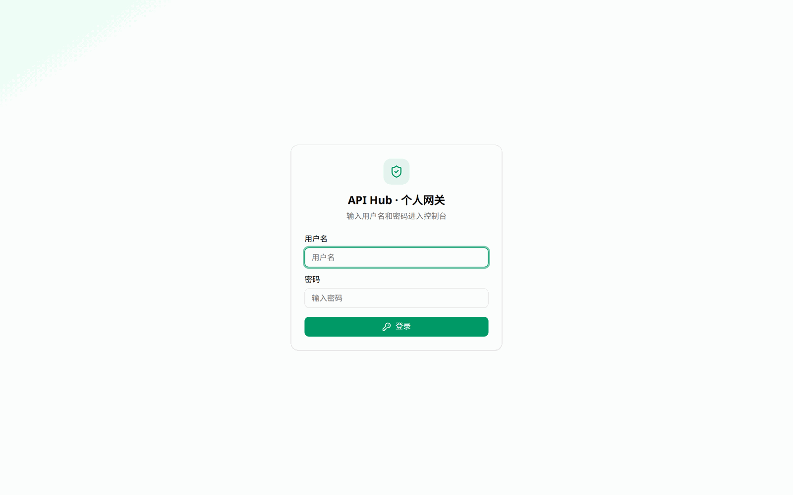
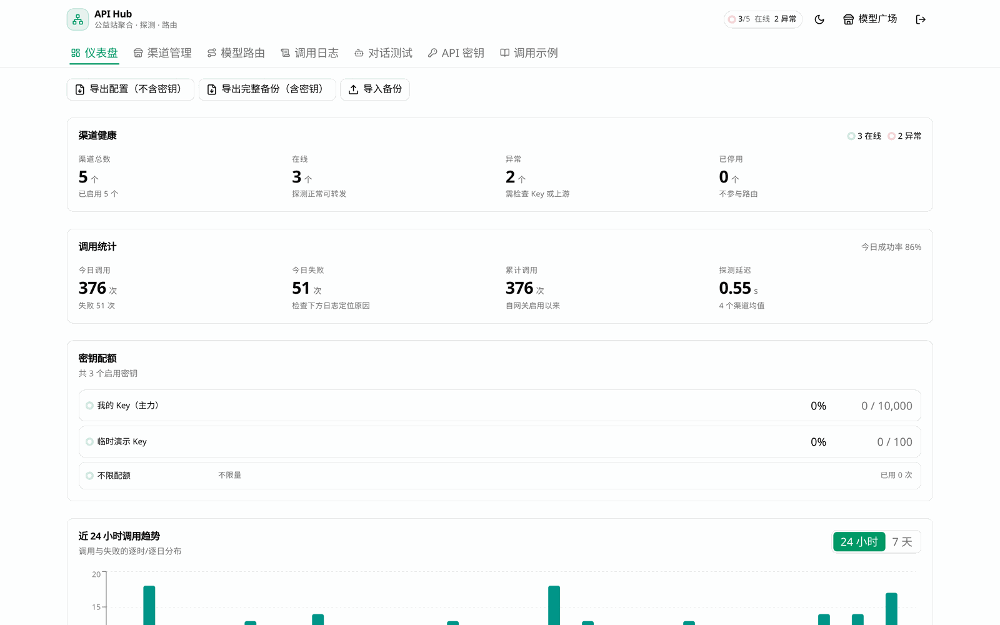
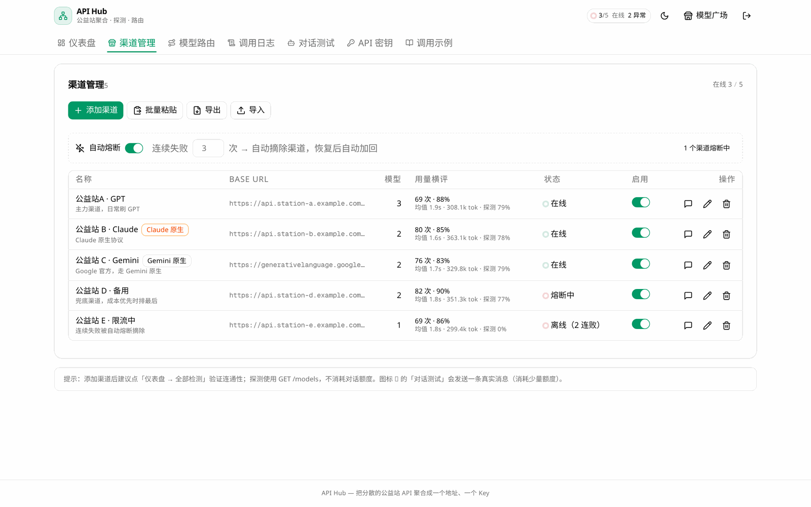
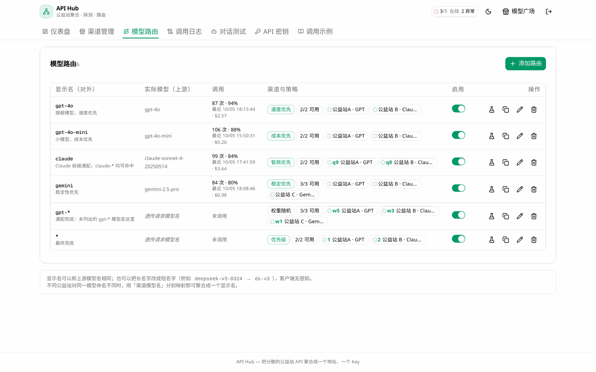
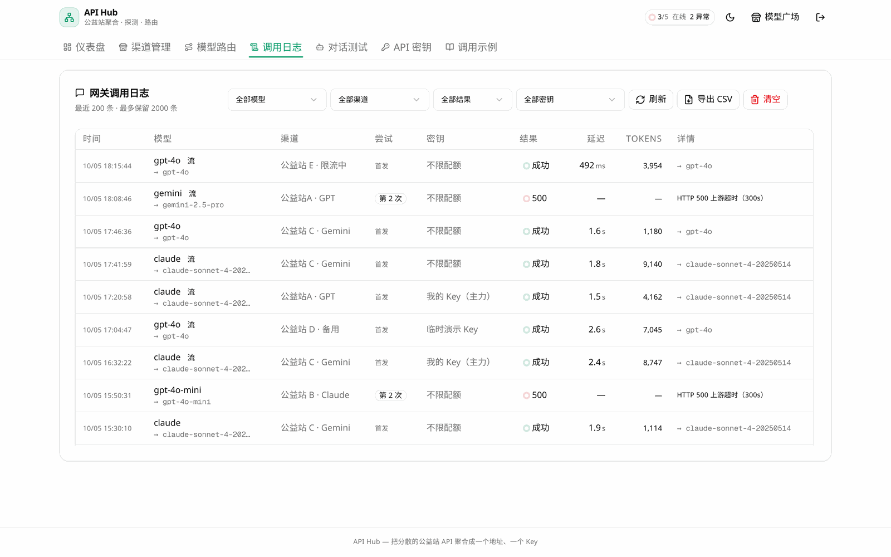
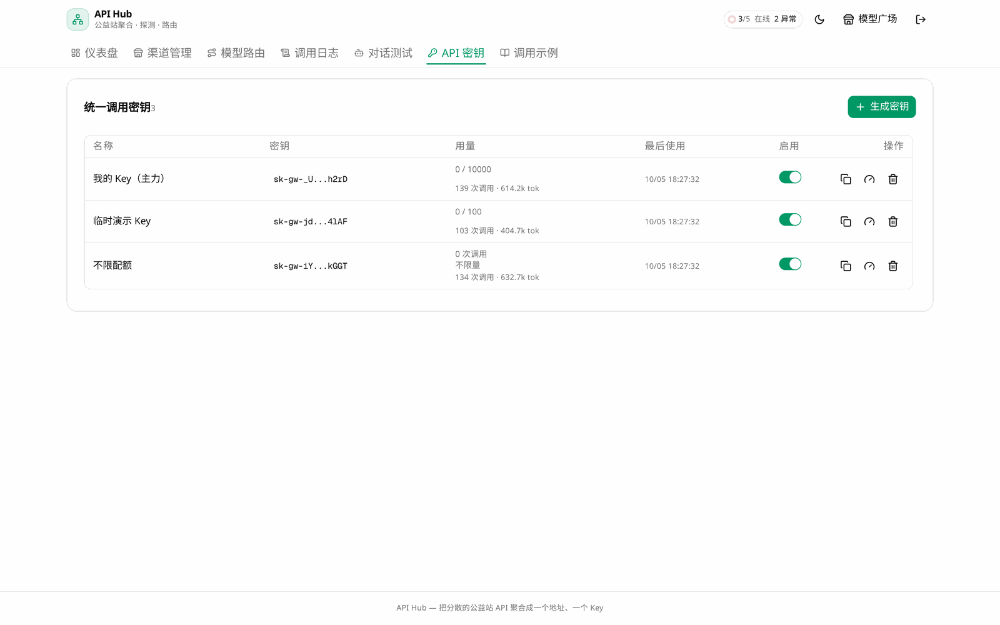
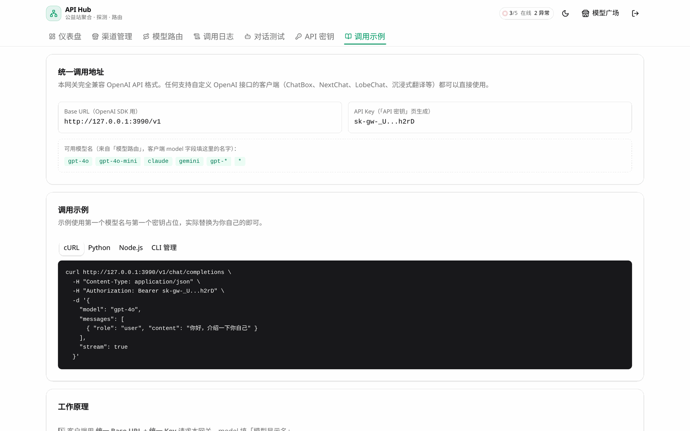
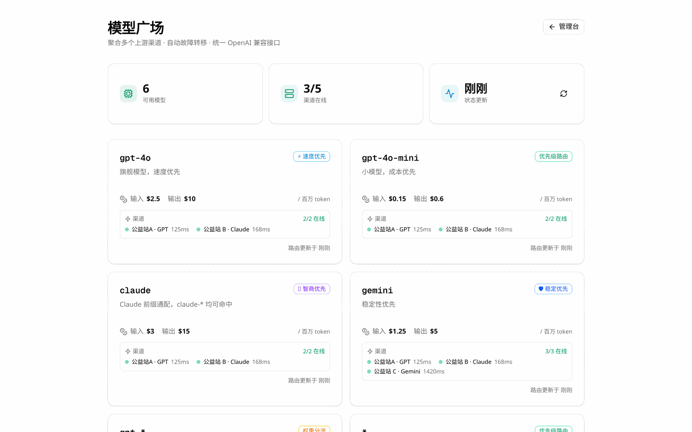
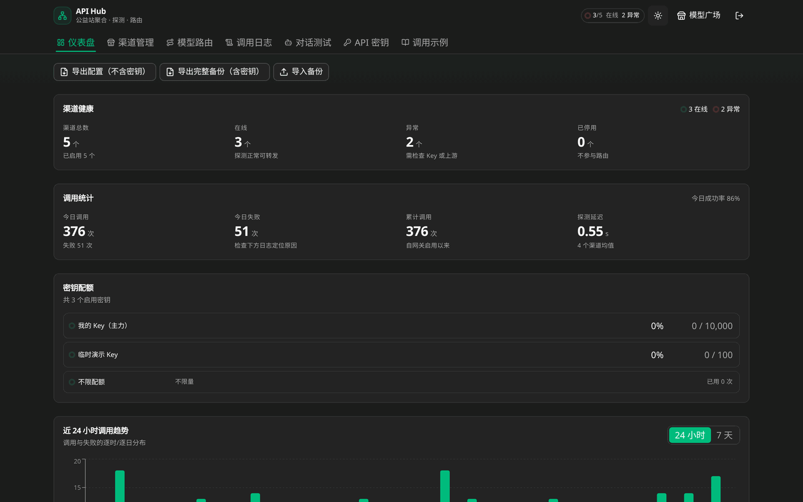

# API Hub · 个人公益站 API 聚合网关

把散落各处的公益站（免费 AI 中转站）Key 聚合成**一个地址、一把 Key**：多渠道管理、实时探测、智能路由、统一调用、用量统计。

> 个人运营使用，非通用商业产品。Private 仓库，请勿分发包含运营数据的副本。

## 功能总览（V27）

| 模块 | 能力 |
|------|------|
| 📡 多渠道管理 | OpenAI 兼容 / Anthropic 原生 / Google Gemini 三协议；baseUrl 路径填错自愈（404 反向变体重试+回写） |
| 🔀 智能路由 | 模型改名 + 渠道编排，6 种负载均衡策略：优先级 / 权重随机 / 速度 / 智商 / 稳定性 / 💰 成本优先；尝试顺序预览与实际转发共用同一实现 |
| 🛡️ 熔断保护 | 探测连续失败自动摘除渠道 + 权重负载恢复；故障转移全链路可视（每次尝试记入日志） |
| 📊 运营数据 | 渠道横评（调用量/成功率/延迟/Token）、24h 探测可用率、密钥级用量统计、仪表盘 Top5 + 7d 趋势 |
| 🔑 统一调用 | 客户端始终用 OpenAI 格式访问网关；密钥配额限制；流式 SSE 全支持 |
| 🔐 管理安全 | 首次自设用户名+密码（scrypt 加盐哈希，明文不落盘）；一次性设置令牌防抢注；登录 5 次错锁 10 分钟；HttpOnly 会话 Cookie 防 XSS 窃取 |
| 🛡️ 后端加固 | 客户端断开即中止上游请求（不白烧额度）；上游错误体密钥自动脱敏；渠道地址默认禁内网（防 SSRF，字面量 + DNS 解析双重判定）；统一 Key 限速 + 配额原子扣减；SQLite WAL + 忙等超时；熔断冷却期防抖动 |
| 🔭 可观测 | 结构化 JSON 日志（级别过滤 + 字段自动脱敏 + 请求 ID 全链路透传）；`/api/health` 健康检查（真探测数据库可读写，异常返回 503）；日志接口游标分页，深翻页不再全表扫 |
| 🌐 配套 | 公开模型广场（脱敏状态页）、明暗双主题、配置备份导出/导入（`percent`/`activeHours`/`metadata` 无损往返） |
| 📦 部署 | Linux 脚本 / Windows 脚本 / Docker Compose / 免依赖 tarball 四种装法；`node doctor.mjs` 环境自检 |
| 🧰 部署物料 | 仓库自带 `deploy/`：systemd unit、nginx 反代（含HTTP/2 版本适配）、logrotate、环境变量样例、Windows 服务注册/卸载脚本 |

## 界面预览

以下截图取自真实运行实例（演示数据），由 `tools/shoot.py` 自动生成，改动 UI 后可一键重拍。
每张图单列全宽显示，手机端直接下滑即可看全，不需要点开放大。

### 登录页

首次访问只有这一屏：设置令牌（首启时印在服务器日志和 `db/setup-token.txt`）→ 自设用户名密码 → 进入面板。



### 仪表盘

一屏看完渠道健康、调用统计、密钥配额与近 24 小时调用趋势。



### 渠道管理

三种上游协议统一管理，每行直接显示在线 / 离线（几连败）/ 熔断中，以及该渠道的调用量、成功率、延迟与 Token 消耗。



### 模型路由

模型改名映射到上游真实模型名，一个模型可绑定多个渠道并设权重/智商/成本，六种负载策略可选。



### 调用日志

逐次调用的成败、HTTP 状态、延迟、Token 与故障转移过程；筛选、导出 CSV、游标翻页。



### API 密钥

网关统一调用密钥，明文只在创建时显示一次，可设配额上限并统计每把 Key 的用量。



### 调用示例

Base URL、Key、各模型显示名都是从当前配置实时取值，可直接复制 cURL / Python / Node.js 片段。



### 模型广场

对外公开的模型状态页，只暴露模型名与可用性，不泄露渠道名与 Key。



### 暗色模式

全站语义色在暗色下同样正确，不是简单反色。



## 一键安装（推荐）

三种装法，按环境挑一种。装完都是常驻服务 + 开机自启，不需要手工敲后续步骤。

| 你的情况 | 用哪种 |
|---------|--------|
| Linux 服务器（有 systemd） | [方式一：install-api-hub.sh](#方式一linux-脚本安装) |
| Windows 10/11 | [方式二：install-api-hub.ps1](#方式二windows-脚本安装) |
| 不想在机器上装 Node / 没有 root / 容器环境 | [方式三：Docker](#方式三docker-一键部署) |

> 完整安装部署（含 WSL2、nssm 手工注册、反代配置、备份恢复、FAQ）见 **[INSTALL.md](INSTALL.md)**；
> 接口清单见 **[docs/API.md](docs/API.md)**；版本变化见 **[CHANGELOG.md](CHANGELOG.md)**。

> 三种方式都需要 GitHub PAT（私有仓库拉源码）。令牌只用于下载源码，脚本不会上传任何数据，
> 别把它写进脚本或提交到仓库。

### 方式一：Linux 脚本安装

```bash
T=ghp_你的GitHub令牌       # 私有仓库需PAT，勾选 repo
curl -fsSL -H "Authorization: Bearer $T" -H "Accept: application/vnd.github.raw" \
  https://api.github.com/repos/plxlaaa/api-hub/contents/install-api-hub.sh \
  -o install-api-hub.sh
bash install-api-hub.sh --token "$T" --domain hub.example.com
```

覆盖 Ubuntu / Debian、RHEL / CentOS / Fedora、Alpine、Arch、openSUSE（自动探测包管理器）。
脚本会：装 Node 20+ / bun → 拉源码 → 装依赖 → 生成 Prisma Client → 建库 → 构建 →
注册 systemd 服务 `api-hub` → 健康检查 → 打印首次设置令牌。

| 动作 | 命令 |
|------|------|
| 更新代码（自动备份 db） | `bash install-api-hub.sh --update --token "$T"` |
| 查看状态 / 设置令牌 | `bash install-api-hub.sh --status` |
| 只做环境自检 | `bash install-api-hub.sh --precheck` |
| 卸载（保留数据库） | `bash install-api-hub.sh --uninstall` |
| 卸载并删除数据库 | `bash install-api-hub.sh --uninstall --purge` |

常用参数：`-d/--dir` 安装目录（默认 `/opt/api-hub`）、`-p/--port`（默认 3000）、
`-b/--branch`（默认 main）、`--domain` 自动装 Caddy 签 HTTPS、`--cn` 走 npmmirror 镜像、
`--firewall` 自动放行端口。

**没有 systemd 的环境**（容器 / 精简镜像 / WSL）也能装：脚本会自动降级为
`nohup` 常驻 + `crontab @reboot` 开机自启，并在日志里提示。更推荐直接用方式三。

### 方式二：Windows 脚本安装

```powershell
$env:GITHUB_TOKEN='ghp_你的GitHub令牌'
irm "https://api.github.com/repos/plxlaaa/api-hub/contents/install-api-hub.ps1" `
  -Headers @{Authorization="Bearer $env:GITHUB_TOKEN"; Accept="application/vnd.github.raw"} `
  -OutFile install-api-hub.ps1
.\install-api-hub.ps1 -Token $env:GITHUB_TOKEN
```

默认注册**计划任务**（用户登录时自动启动）。装了 [nssm](https://nssm.cc/) 的话会被自动识别，
直接注册为真正的 Windows 服务（开机即启，无需登录）；没装则用计划任务。
`-Update` / `-Status` / `-Uninstall` / `-Precheck` 与 Linux 版对应。

### 方式三：Docker 一键部署

不想在宿主机装 Node/bun，或者机器上没有 root 权限时用这个。

```bash
git clone https://github.com/plxlaaa/api-hub.git && cd api-hub
cp .env.example .env            # 可选：改端口 / 时区
docker compose up -d --build
docker compose logs -f         # 看首次设置令牌
```

数据库在具名卷 `api-hub-data` 里（容器重建不丢）。国内网络慢可加 `CN_MIRROR=1` 走镜像加速。

| 动作 | 命令 |
|------|------|
| 查看状态 | `docker compose ps` |
| 看日志 | `docker compose logs -f` |
| 更新 | `git pull && docker compose up -d --build` |
| 停止 | `docker compose down`（数据保留） |
| 备份数据库 | `docker run --rm -v api-hub-data:/data -v $PWD:/backup alpine tar czf /backup/db-$(date +%F).tgz -C /data .` |

也可以在 Linux 脚本里直接加 `--docker` 走同一套流程。

### 方式四：免依赖 tarball（只要 Node 20+）

生产机不想装 Node 依赖栈时，在有开发环境的机器上打包带走：

```bash
npm run build
bash scripts/pack-standalone.sh     # 产物：api-hub-standalone.tar.gz
```

目标机器上解压即可运行（脚本已自动剔除 `db/`，不会把你的 API Key 打进包）：

```bash
sudo mkdir -p /opt/api-hub && sudo tar xzf api-hub-standalone.tar.gz -C /opt/api-hub
sudo cp /opt/api-hub/deploy/systemd/api-hub.service /etc/systemd/system/
sudo systemctl daemon-reload && sudo systemctl enable --now api-hub
```

> tarball 不含 Prisma CLI，**无法执行 schema迁移**。本项目启动时自动建表（幂等），
> 涉及字段变更时建议用源码部署，或先在旧机器迁移再把 `db/` 一起带走。

### 想自己接管 systemd / nginx / Windows 服务？

仓库的 `deploy/` 目录带了现成物料，全部经过真实工具校验
（`systemd-analyze verify`、`nginx -t`、`logrotate -d`、PowerShell Parser）：

| 路径 | 用途 |
|------|------|
| `deploy/systemd/api-hub.service` | systemd 服务单元（含 `EnvironmentFile` 集中配置） |
| `deploy/nginx/api-hub.conf` | 反向代理 + 限流 |
| `deploy/nginx/api-hub-http2.conf` | HTTP/2 片段（nginx ≥1.25 与 <1.25 两种写法） |
| `deploy/logrotate/api-hub` | 文件式日志轮转（journald 之外用） |
| `deploy/env/api-hub.env.example` | 端口/时区/日志级别配置样例 |
| `deploy/windows/register-service.ps1` | Windows 服务注册（含崩溃重启、日志轮转） |
| `deploy/windows/unregister-service.ps1` | 卸载（默认先备份 `db/`） |

完整的**防火墙**、**升级与卸载**、**FAQ** 见 [INSTALL.md](INSTALL.md)。

## 手动开始

前置：Node.js ≥ 20（推荐 bun）。上面脚本已覆盖的场景不用看这段。

```bash
# 先跑环境自检
node doctor.mjs              # 或 bun run doctor，加 --json 输出机器可读结果

# 安装依赖
bun install                # 或 npm install

# 启动（首次启动会自动建表，无需手动 db:push）
bun run dev                # http://localhost:3000
```

首次进入面板会要求创建管理员账号：**用户名 + 密码 + 一次性设置令牌**。令牌在服务启动日志里打印，
或见本机 `db/setup-token.txt`（权限 600，仅本机可见）——它用于防止面板暴露公网时被人抢先注册，
建号成功即焚毁。之后用用户名+密码登录，再到「渠道管理」添加你的上游 Key。

详细部署步骤与故障排查见 [HANDOVER.md](HANDOVER.md)；数据库（含密钥）不在仓库内，用管理台「配置备份」迁移。

装完服务在哪：

| 项 | Linux脚本 | Windows 脚本 | Docker |
|------|-------|-----------|--------|
| 安装目录 | `/opt/api-hub` | `C:\api-hub` | 镜像内`/app` |
| 数据库 | `<目录>/db/custom.db` | `<目录>\db\custom.db` | 卷 `api-hub-data` |
| 常驻方式 | systemd `api-hub` | 计划任务 `APIHub` 或 nssm 服务 | 容器 `restart: unless-stopped` |
| 看日志 | `journalctl -u api-hub -f` | `Get-Content server.log -Tail 50` | `docker compose logs -f` |

## 统一调用示例

```bash
curl http://localhost:3000/v1/chat/completions \
  -H "Authorization: Bearer sk-gw-你的统一Key" \
  -H "Content-Type: application/json" \
  -d '{"model": "claude", "messages": [{"role": "user", "content": "hi"}]}'
```

`model` 填模型路由的显示名；网关按路由策略选渠道、自动故障转移，客户端无感。

## 架构与扩展

核心扩展点收敛为三层，新能力以「注册/新增文件」接入，主流程零改动：

1. **协议适配器**（`src/lib/adapters/`）——加新上游协议 = 新增一个 adapter 文件 + 注册一行
2. **路由策略注册表**（`src/lib/route-order.ts`）——加新策略 = 一个排序函数 + 注册一行
3. **metadata Json 字段**——实验配置先放 metadata 验证，稳定再升级正式列

详见 [ARCHITECTURE.md](ARCHITECTURE.md)。

## 健康检查与日志排错

服务提供无需鉴权的健康端点，可直接给容器/systemd 用：

```bash
curl -fsS http://127.0.0.1:3000/api/health
# {"status":"ok","uptimeSec":86400,"db":{"ok":true},"checksMs":1,...}     ← 200
# {"status":"degraded",...,"db":{"ok":false,"error":"..."}}             ← 503（DB 不可用）
```

`503` 表示进程还活着但数据库不可用，**不该再往里导流量**。
注意别用 `/api/auth/status` 当探针——它只反映「是否已初始化」，DB 挂了照样返回 200。

日志为结构化 JSON，每条含 `ts` / `level` / `msg`，字段自动脱敏（不会把上游 Key 写进日志）。
网关请求带 `requestId`，与响应头 `X-Request-Id` 一致，可直接串联整条链路：

```bash
journalctl -u api-hub -f | grep 'a1b2c3d4'   # Linux
docker compose logs -f api-hub                # Docker
```

| 环境变量 | 默认 | 说明 |
|---------|------|------|
| `LOG_LEVEL` | `info` | `debug` / `info` / `warn` / `error` / `silent` |
| `LOG_FORMAT` | `json` | `json`（采集）/ `text`（终端人读） |
| `PRISMA_LOG` | — |设为 `query` 打印 SQL，排查慢查询 |

更多排错场景见 [INSTALL.md](INSTALL.md#常见问题faq)。

## 技术栈

Next.js (App Router) · TypeScript · Prisma + SQLite · Tailwind CSS · shadcn/ui · TanStack Query

## 安全须知

- `db/custom.db` 含明文 API Key：勿上传公开仓库/网盘，勿裸暴露公网（如需外网访问请加反向代理 + 强密码）
- 管理员密码以 scrypt 加盐哈希存于本机 `db/credentials.env`（权限 600，明文不落盘），同样勿提交/外传
- 管理端已做服务器面板级防护：一次性设置令牌（防抢注）、登录 5 次错锁 10 分钟、HttpOnly 会话 Cookie
- 面板若要暴露公网，**务必配 HTTPS**（域名 + 反向代理）；`公网IP:端口` 裸 HTTP 会让登录密码明文过网
- 反向代理必须注入 `X-Real-IP`：登录防爆破只信任这个头，不注入的话客户端可自带该头伪造 IP 绕过锁定
- 只由反代对外时，让服务只监听本机（`HOSTNAME=127.0.0.1`），避免端口被直接暴露公网
- 渠道 baseUrl 默认拒绝内网地址与云元数据地址（防 SSRF）；确需内网自建渠道，在该渠道 metadata 里加 `allowInternal: true`
- 统一 Key 默认限速 60 次/分钟，可在密钥 metadata 里用 `rateLimitPerMin` 调整（0 = 不限）
- 健康检查端点 `/api/health` 只回粗粒度状态、无敏感信息，可安全暴露；日志字段会自动脱敏，但仍不要把日志目录设为可公开访问
- 捐赠渠道的 Key 请仅用于个人额度，遵守各公益站规则

## 开发

```bash
bun run typecheck   # tsc 类型检查
bun run test        # 单元测试（Node 内置 runner，零依赖）
bun run lint
bun run doctor      # 环境自检
```

### 重拍文档截图

改完 UI 后，把服务跑起来再执行（需 `pip install playwright && playwright install chromium`）：

```bash
python3 tools/shoot.py http://127.0.0.1:3000 docs/screenshots <用户名> <密码>
```

脚本会登录、逐个标签页截图、切一次暗色模式，再把图缩到 1600px 宽并量化到 256 色
（单张约 40KB），直接覆盖 `docs/screenshots/`。README / INSTALL / docsAPI 的引用无需改动。
