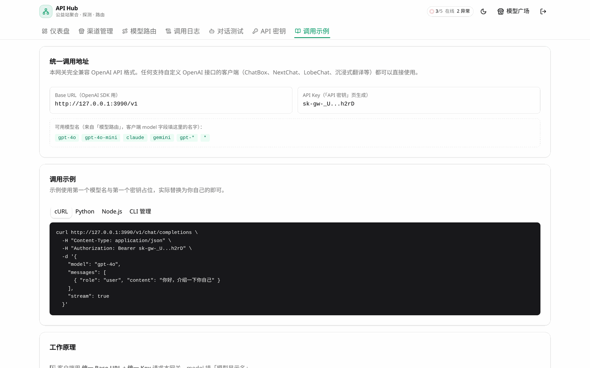
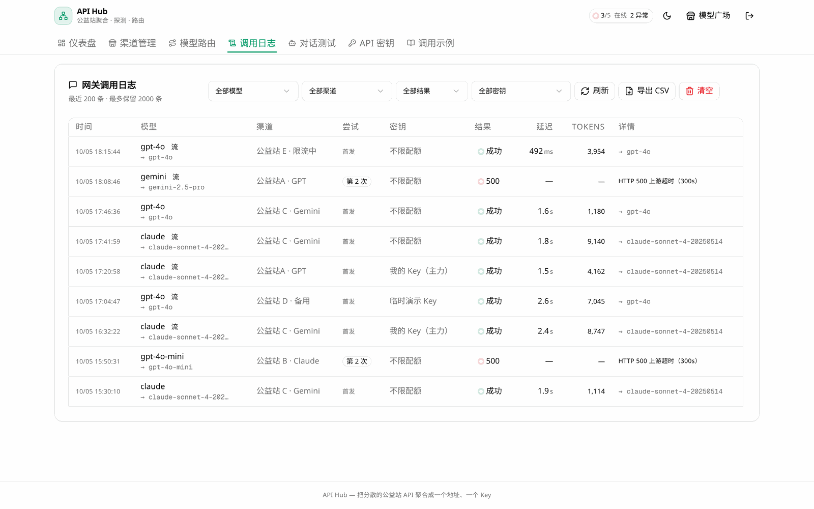
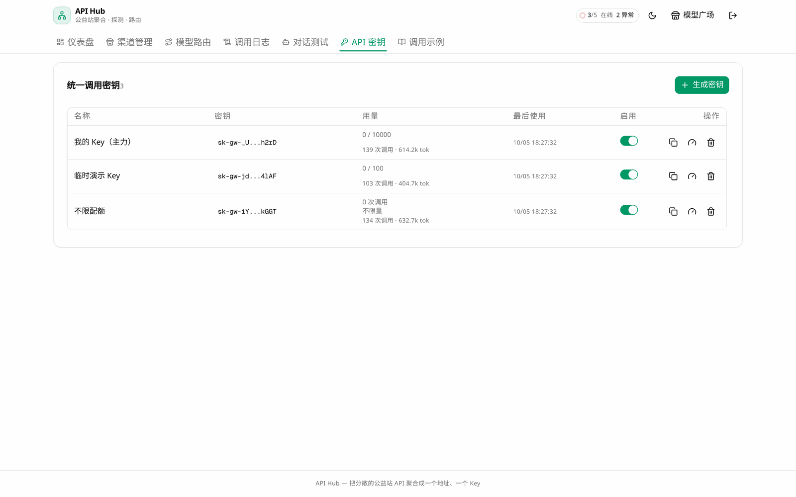

# API 文档

API Hub 分两类接口：**网关接口**（给调用方用，OpenAI 兼容）与**管理接口**（给管理台用，
Cookie 会话鉴权）。部署与安装见 [INSTALL.md](../INSTALL.md)。

- [网关接口（OpenAI 兼容）](#网关接口openai-兼容)
- [管理接口](#管理接口)
- [健康检查](#健康检查)
- [通用约定](#通用约定)

> 文档里的 Base URL、Key、模型名，都可以在管理台「调用示例」页直接复制实时值：
>
> 
>
> 上面每个接口的路径与参数，都能在该页对应位置找到可直接复制的现成请求。

---

## 通用约定

### 认证

| 接口类型 | 方式 |
|---------|------|
| 网关 `/v1/*` | `Authorization: Bearer sk-gw-xxx`（管理台创建的统一 Key） |
| 管理 `/api/*`（除公开与健康检查外） | HttpOnly 会话 Cookie（`ah_session`），登录后由服务端下发 |
| 少数接口 | 兼容 `Authorization: Bearer <会话 JWT>` |

### 请求 ID

所有响应都带 `X-Request-Id` 响应头。同时传入合法的 `X-Request-Id` 请求头会被原样透传
（字符集 `A-Za-z0-9._:-`，最长 64），否则服务端生成。

网关请求产生的全部日志都带同一个 `requestId`，**拿它可直接 grep 出整条链路**：

```bash
grep 'a1b2c3d4' api-hub.log
```

### 错误体

管理接口：

```json
{ "error": "名称不能为空", "requestId": "a1b2c3d4" }
```

校验失败时附`fields` 逐字段说明，便于前端一次把表单标全：

```json
{
  "error": "name 不能为空；baseUrl 必须为字符串",
  "fields": { "name": "不能为空", "baseUrl": "必须为字符串" },
  "requestId": "a1b2c3d4"
}
```

网关接口保持 OpenAI 兼容结构（改动会破坏 SDK 解析，勿动）：

```json
{ "error": { "message": "...", "type": "api_error", "code": null } }
```

### 分页（游标式）

列表接口采用游标分页。响应信封：

```json
{ "items": [...], "nextCursor": "eyJ0Ijoi...", "hasMore": true, "total": 128 }
```

- `nextCursor` 为 `null` 表示已到末页
- 非法/过期游标会被忽略并退回首页，不会报错
- `total` 仅在传 `withTotal=1` 时计算（全表 count 在大表上不便宜）

翻页就是把上一页的 `nextCursor` 原样回传：

```bash
curl "http://hub:3000/api/request-logs?limit=50"
curl "http://hub:3000/api/request-logs?limit=50&cursor=<nextCursor>"
```

---

## 健康检查

### `GET /api/health`

无需鉴权，可安全暴露。**推荐作为容器/systemd 探针**。

响应 `200`（正常）：

```json
{
  "status": "ok",
  "uptimeSec": 86400,
  "db": { "ok": true },
  "checksMs": 1,
  "timestamp": "2026-10-05T02:00:00.000Z"
}
```

响应 `503`（数据库不可用）：

```json
{
  "status": "degraded",
  "uptimeSec": 12,
  "db": { "ok": false, "error": "The table `main.RequestLog` does not exist..." },
  "checksMs": 2,
  "timestamp": "2026-10-05T02:00:00.000Z"
}
```

> ⚠️ **不要用 `/api/auth/status` 当探针**：它只反映「是否已初始化」，
> 数据库挂了照样返回 200，会让容器被误判 healthy 继续导流量。

---

## 网关接口（OpenAI 兼容）

统一入口，客户端始终用 OpenAI 格式访问。

### `POST /v1/chat/completions`

标准 OpenAI 聊天接口，支持流式（`stream: true`，SSE 全透传）。

请求体额外约束：

| 约束 | 值 | 违规响应 |
|------|-----|---------|
| 请求体大小 | 上限 10MB | `413` |
| 模型名| 必填 | `400` |
| JSON 合法性 | — | `400` |

处理流程：鉴权 → 限速/配额 → 模型名解析路由 → 按策略排序渠道 → 逐个转发，
非 2xx 自动故障转移到下一渠道。每次尝试都记入调用日志。

响应头：

| 头| 说明 |
|----|------|
| `X-Gateway-Channel` | 实际命中的渠道名（URL 编码） |
| `X-Request-Id` | 本次调用的追踪 ID |

错误类型：

| type | 状态码 | 场景 |
|------|-------|------|
| `invalid_request_error` | 401 | Key 无效或已禁用 |
| `invalid_request_error` | 404 | 模型不存在且无兜底路由 |
| `insufficient_quota` | 429 | 该 Key 配额用尽 |
| `rate_limit_error` | 429 | 触发限速（带 `Retry-After`） |
| `api_error` | 502 | 所有渠道均失败（错误体含各渠道失败原因） |
| — | 413 | 请求体超限 |
| — | 499 | 客户端主动断开 |

### `GET /v1/models`

返回所有启用路由的模型显示名（OpenAI `list` 格式）。纯兜底路由 `*` 不出现在列表里。

---

## 管理接口

均需会话 Cookie（`ah_session`）。未登录返回 `401`。

### 认证

| 方法 | 路径 | 说明 |
|------|------|------|
| `GET` | `/api/auth/status` | 是否已初始化（`{ initialized }`）。**公开** |
| `POST` | `/api/auth/setup` | 首次设置管理员（需一次性设置令牌） |
| `POST` | `/api/auth/login` | 登录，下发会话 Cookie |
| `POST` | `/api/auth/logout` | 登出，清 Cookie |
| `GET` | `/api/auth/me` | 当前登录用户 |

登录防爆破：同一 IP 连续失败 5 次锁定 10 分钟。
只信 `X-Real-IP`（反代覆盖写入），**刻意不信任 `X-Forwarded-For`**，否则可自带该头绕过锁定。

### 渠道

| 方法 | 路径 | 说明 |
|------|------|------|
| `GET` | `/api/channels` | 渠道列表 + 横评统计 + 24h 可用率（不含 apiKey） |
| `POST` | `/api/channels` | 新建渠道 |
| `PUT` | `/api/channels/{id}` | 局部更新 |
| `DELETE` | `/api/channels/{id}` | 删除 |
| `POST` | `/api/channels/{id}/probe` | 立即探测单个渠道 |
| `POST` | `/api/channels/probe-all` | 探测全部渠道 |
| `POST` | `/api/channels/{id}/test-chat` | 用该渠道跑一次测试对话 |
| `POST` | `/api/channels/batch` | 批量启停 |
| `POST` | `/api/channels/fetch-models` | 拉取上游模型列表 |

`POST /api/channels` 请求字段：

| 字段 | 必填 | 约束 |
|------|------|------|
| `name` | ✅ | ≤ 80 字符 |
| `baseUrl` | ✅ | ≤ 500 字符；**默认禁内网**（防 SSRF） |
| `apiKey` | ✅ | ≤ 500 字符 |
| `models` | — | 数组或换行/逗号分隔字符串，单项≤ 120 字符 |
| `apiFormat` | — | `openai`(默认) / `anthropic` / `gemini` |
| `remark` | — | ≤ 500 字符 |
| `enabled` | — | 布尔 |
| `metadata` | — | JSON 对象 |

**SSRF 防护**：`baseUrl` 会被服务端主动 fetch，内网地址与云元数据端点默认拒绝。
确需内网自建渠道时，在 `metadata.allowInternal: true` 放行。

### 路由（模型改名与编排）

| 方法 | 路径 | 说明 |
|------|------|------|
| `GET` `POST` | `/api/routes` | 路由列表 / 新建 |
| `PUT` `DELETE` | `/api/routes/{id}` | 更新 / 删除 |
| `POST` | `/api/routes/preview` | 预览尝试顺序（与实际转发共用同一实现） |

负载均衡策略：`priority`（配置顺序）、`weighted`（权重随机）、
`speed`（速度）、`quality`（质量）、`stability`（稳定性）、`cost`（成本）。

### 统一密钥

| 方法 | 路径 | 说明 |
|------|------|------|
| `GET` `POST` | `/api/tokens` | 密钥列表（key 掩码）/ 新建 |
| `PUT` `DELETE` | `/api/tokens/{id}` | 更新 / 删除 |

新建时返回完整 key，**仅此一次可见**。配额字段 `quotaLimit`：缺省或 `null` = 不限，
正整数 = 请求次数上限。

### 日志

| 方法 | 路径 | 说明 |
|------|------|------|
| `GET` | `/api/request-logs` | 调用日志（游标分页，`limit`/`cursor`/`withTotal`） |
| `DELETE` | `/api/request-logs` | 清空调用日志 |
| `GET` | `/api/request-logs/export` | 导出 CSV（带 BOM，Excel 直开不乱码，最多 5000 条） |
| `GET` | `/api/logs` | 探测日志（游标分页，默认 60 条） |

筛选参数（两者通用）：`tokenName`、`model`、`channelName`、`ok`（`1` 仅成功 / `0` 仅失败）。
`tokenName=-` 表示筛选「管理测试」这类无密钥的记录。

这两个接口在管理台上的呈现（截图取自真实实例，单列全宽便于手机端查看）。

**`GET /api/request-logs` 调用日志**：「结果」列失败行会显示 HTTP 状态与错误摘要；
「尝试」列 >1 表示发生过故障转移，说明至少一个渠道失败后由下一个渠道兜住了——
排查稳定性问题从这里入手最快。



**`GET /api/tokens` 密钥配额**：每把 Key 的配额上限、已用量、调用次数与最近使用时间，
都是 `quotaLimit` / `quotaUsed` 等字段的直接呈现。




### 统计与其它

| 方法 | 路径 | 说明 |
|------|------|------|
| `GET` | `/api/stats` | 仪表盘统计 |
| `GET` | `/api/overview` | 一站式汇总（CLI / 仪表盘） |
| `GET` `PUT` | `/api/settings` | 熔断设置（`circuitBreaker`、`cbThreshold`） |
| `GET` | `/api/config/export` | 导出全部配置 |
| `POST` | `/api/config/import` | 导入配置 |
| `GET` | `/api/public/square` | 模型广场公开数据。**公开**，已脱敏 |
| `POST` | `/api/test-chat` | 一键对话测试（管理员，不消耗配额） |

---

## 限流与配额

| 维度 | 阈值 | 位置 |
|------|------|------|
| 登录失败 | 同 IP 5 次 / 10 分钟 | 应用层，信任 `X-Real-IP` |
| 网关调用 | 默认 60 次/分钟/Key | `metadata.rateLimitPerMin` 可覆盖，`0` = 不限 |
| 配额 | 按 Key 请求次数上限 | 原子扣减，并发下不会超发 |

限流状态存在进程内存，多实例部署时每个实例各算各的。本项目定位单机单实例部署；
若要水平扩展，需把计数迁到 Redis 或数据库。